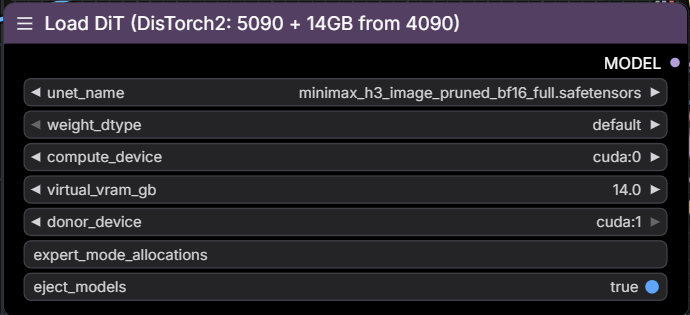

# ComfyUI-MultiGPU - DisTorch2 slim

## Why this fork exists

I had a 37.5 GB diffusion model (MiniMax H3 Image in bf16) and a 32 GB card. ComfyUI loaded
29 GB of it and streamed the remaining 9.5 GB from system RAM on every single step: 25.7 seconds
per step, 2.5 minutes for six steps. A second GPU sat idle in the same machine.

Upstream's DisTorch2 loader solves exactly this: it places part of the model on the donor card at
load time, so nothing has to be streamed per step. Same seed, same output, 7.05 s/step.

Two things made the upstream package unusable as shipped on ComfyUI 0.46:

1. It imports `lowvram_available` from `comfy.model_management`, which 0.46 removed. DisTorch2
   fails to load with `cannot import name 'lowvram_available'`.
2. Its other half - the cross-device CLIP/VAE loaders and the `comfy_kitchen` DLPack guard - moves
   already-loaded int8 tensors between GPUs at runtime, which raises `cudaErrorIllegalAddress` on
   consumer cards without peer-to-peer access. It crashed three times before I gave up on it.

So this fork fixes (1), removes (2), and deletes everything that is not needed to split a UNET.
One node is registered. Nothing else runs.

## The node

`UNETLoaderDisTorch2MultiGPU` - "Load Diffusion Model (DisTorch2, multi-GPU)"




| input | meaning |
|---|---|
| `unet_name` | the diffusion model |
| `weight_dtype` | `default` unless you know better |
| `compute_device` | where the model runs, usually `cuda:0` |
| `virtual_vram_gb` | how much VRAM to borrow from the donor |
| `donor_device` | the second GPU, usually `cuda:1` |
| `expert_mode_allocations` | leave empty; manual allocation string |
| `eject_models` | free the model after the run |

### Sizing virtual_vram_gb

Run once with `0` and read the log. DisTorch2 tells you the number:

```
Model size (37.55GB) is larger than 90% of available VRAM on: cuda:0 (28.63GB).
To prevent an OOM error, set 'virtual_vram_gb' to at least 8.92
```

Set it a couple of GB above that minimum. More is not better: the split is sequential, so every
extra GB moves layers onto the slower card and costs time.

## Measured

MiniMax H3 Image, 37.5 GB bf16, 4736x3552, RTX 5090 + RTX 4090, no P2P:

| setup | per step | 6 steps |
|---|---|---|
| single GPU, 9.5 GB offloaded to RAM | 25.7 s | 2:34 |
| DisTorch2, donor 14 GB | **7.05 s** | 0:42 |
| DisTorch2, donor 18 GB | 8.00 s | 0:48 |

Output was byte-for-byte identical to the single-GPU render.

## What changed vs upstream

* Registers only `UNETLoaderDisTorch2MultiGPU`.
* Disables the cross-device patch stack (DLPack guard, stream patch, sample device guard).
* Imports `lowvram_available` defensively with a `True` fallback.
* Dropped node docs, assets, CI and example workflows.

## Install

```
cd ComfyUI/custom_nodes
git clone https://github.com/wolfden/ComfyUI-MultiGPU
```

This fork is not in ComfyUI-Manager's catalog; install by Git URL.

MIT, as upstream. Credit for DisTorch2 and the loader itself is pollockjj's.
